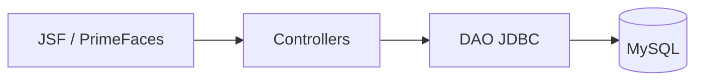

<div align="center">

# Locadora de Games | Java Web

### Sistema de locação de jogos com gestão de catálogo, clientes, funcionários, locações, devoluções e indicadores financeiros.

[](https://github.com/KalleoLeandro/java-web-locadora)


      

</div>

---

## ✨ Visão geral

Sistema de locação de jogos com gestão de catálogo, clientes, funcionários, locações, devoluções e indicadores financeiros.

## 🚀 O que você encontra aqui

- **Cadastro de jogos por plataforma, gênero, faixa etária e disponibilidade**
- **Gestão de clientes e funcionários**
- **Locação, devolução e relatórios financeiros**
- **Inicialização de banco e dados de demonstração**

## 🧰 Tecnologias

`Java`, `JSF`, `PrimeFaces`, `MySQL`, `JDBC`, `Maven`, `Tomcat`.

## 🖼️ Visão técnica / demonstração



## ▶️ Como explorar / executar

```bash
mvn clean package
```
Configure o MySQL nas classes utilitárias e publique o `target/locadora.war` no **Tomcat 9**. O projeto usa `javax.*`/JSF; leia o README original e os arquivos `src/main/resources/db/init.sql` e `WEB-INF/web.xml` para a inicialização do banco.

## 📁 Repositório

```bash
git clone https://github.com/KalleoLeandro/java-web-locadora.git
cd java-web-locadora
```

[Consultar os arquivos e o histórico do projeto](https://github.com/KalleoLeandro/java-web-locadora)

## 📝 Observações

> **Compatibilidade:** a documentação do projeto informa ambiente Java 21/Tomcat 9, porém o `pom.xml` consultado declara `source/target 1.8`. Confirme a configuração real do ambiente antes de compilar; Tomcat 10+ exige migração para Jakarta.

---

<div align="center">

Desenvolvido e mantido por [Kalleo Leandro](https://github.com/KalleoLeandro).

</div>
